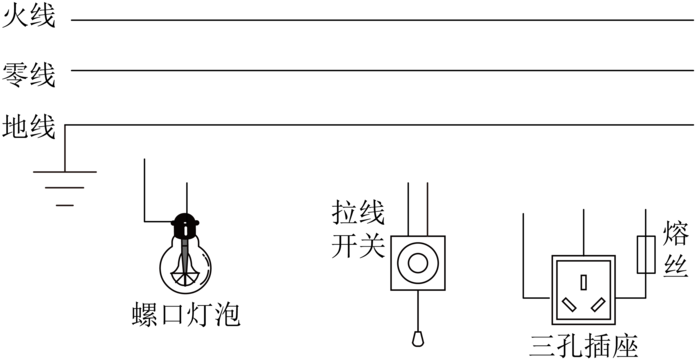

# Physics - 题目 2582

**ID**: 4f40b659c74743a7ac015f0241595364
**年级**: Grade 9
**难度**: Easy
**题型**: Drawing

## 题目
请将如图所示元件，连接成符合安全用电要求的家庭电路。​​​​​​​‌

## 解答

1. 为了断开开关能切断灯泡的电流，灯泡的接法是火线先进入开关，再进入灯泡顶端的金属点，零线直接接在灯泡的螺旋套上；三孔插座按照上孔接地线，左孔接零线，右孔接火线，如下图所示：
2. 

## 知识点

**中文**:
  - 家庭电路的连接

**English**:
  - Connection of Household Circuits

---
