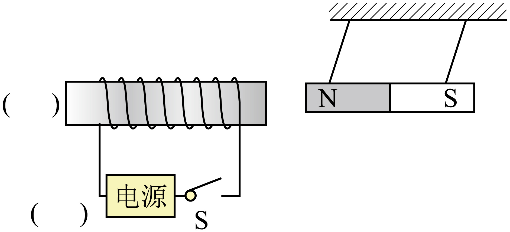

# Physics - 题目 633

**ID**: 524996c649d44e5dbdcdfd61b0a661f1
**年级**: Grade 9
**难度**: Easy
**题型**: Drawing

## 题目
如图所示，在螺线管旁悬挂一条形磁体。​​​​​​​‌闭合开关后，条形磁体向左偏。请在括号内标出：（1）通电螺线管的“N”或“S”极；（2）电源的“+”或“-”极。

## 解答

1. 由图可知，条形磁体被螺线管吸引，根据异名磁极相互吸引可知，螺线管的右端为S极，左端为N极。根据安培定则可知，电流从螺线管的右侧流入，左侧流出，所以电源的左端为负极。

## 知识点

**中文**:
  - 安培定则及其应用
  - 磁极间的相互作用

**English**:
  - Ampere's Rule and Applications
  - Interaction between Magnetic Poles

---
