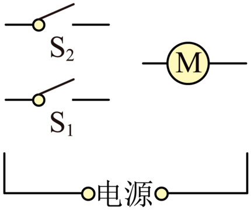

# Physics - 题目 1231

**ID**: 60b174e9384f4d27b94c7830de9f6fb5
**年级**: Grade 9
**难度**: Easy
**题型**: Drawing

## 题目
如图是学校档案室的人脸和指纹双识别系统，要求人脸识别成功（S_{1}闭合），且指纹识别成功（S_{2}闭合）才能由电动机M自动打开防盗门锁，请把电路连接完整。​​​​​​​‌

## 解答

1. 由题意知，两个开关都闭合时，电动机才工作，所以两个开关与电动机串联在电路中，作图如下：
2. 

## 知识点

**中文**:
  - 串、并联电路的设计

**English**:
  - Designing Series and Parallel Circuits

---
