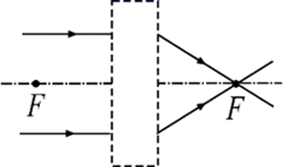

# Physics - 题目 80

**ID**: 8c5bc1baa022459b921699f00e454d0a
**年级**: Grade 9
**难度**: Easy
**题型**: Drawing

## 题目
根据图中给出的入射光线和折射光线，在方框内画出一个适当类型的透镜。​​​​​​​‌

## 解答

1. 平行于主光轴的光线经凸透镜折射后折射光线通过焦点，应画入凸透镜，如图：
2. 

## 知识点

**中文**:
  - 作透镜的光路图

**English**:
  - Drawing Ray Diagrams for Lenses

---
