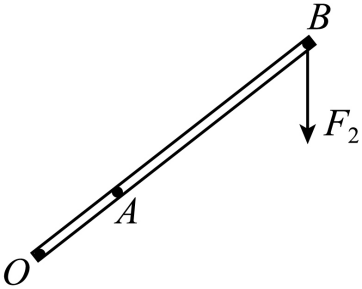

# Physics - 题目 1425

**ID**: b5b7f909e23f489fb989adcdff59fb95
**年级**: Grade 9
**难度**: Easy
**题型**: Drawing

## 题目
“开拓学生视野，创新教学模式”，五月份十八中师生来到平江起义纪念馆开展研学活动，李同学带了手机自拍杆记录下珍贵的研学画面。​​​​​​​‌如图所示，是该同学使用自拍杆辅助手机进行自拍时杠杆筒化图，自拍杆可以看作是一个费力杠杆。他一只手握住固定点O，另一只手在A点施力调节手机的位置，手机固定在B点。请在图中画出阻力臂L_{2}。

## 解答

1. 先延长阻力的作用线，由支点向阻力的作用线作垂线，垂线段即为阻力的力臂L_{2}，故作图如下：
2. 

## 知识点

**中文**:
  - 力和力臂的作图

**English**:
  - Drawing Force and Moment Arm Diagrams

---
