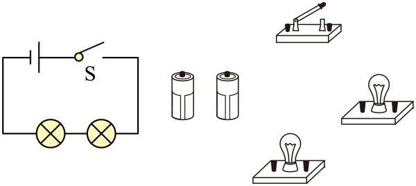

# Physics - 题目 2251

**ID**: cec538b824f1454099a436d225948668
**年级**: Grade 9
**难度**: Easy
**题型**: Drawing

## 题目
如图所示，根据电路图连接实物电路。​​​​​​​‌（导线不能交叉）

## 解答

1. 由图电路可知，电流从电源正极流出后到开关，依次到两个灯泡，再回到负极，两灯泡串联，具体实物图如下所示：
2. 

## 知识点

**中文**:
  - 连接电路实物图

**English**:
  - Connecting Physical Circuits

---
