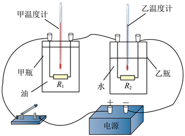

# Physics - 题目 382

**ID**: 25f125e69ac846e38c5997de29215f1c
**年级**: Grade 9
**难度**: Easy
**题型**: Experiment

## 题目
如图，定值电阻R_{1}和R_{2}分别加热容器内质量相等的油和水（均未沸腾），电阻产生的热量全部被油和水吸收。​​​​​​​‌甲温度计升温比乙温度计少。已知比热容c_{乙水}=4.2×10^{3}J/（kg·℃），c_{甲油}=1.97×10^{3}J/（kg·℃）。（1）根据上述实验比较两电阻放出的热量大小（写出依据）。。（2）由上述信息，可判断R_{1}R_{2}（选填“>”“=”“<”）。

## 解答

1. （1）[1]根据 $Q{{}_{吸}}=cmΔt$ 可知，m相同、c_{甲油}<c_{乙水}、t_{甲油}<t_{乙水}，可知Q_{甲吸}<Q_{乙吸}。
2. （2）[2]由上述信息，有Q_{吸}＝Q_{放}，可知R_{1}放出的热量小于R_{2}放出的热量，即R_{1}<R_{2}（选填“>”“=”“<”）。

## 知识点

**中文**:
  - 物质的比热容探究实验

**English**:
  - Experiment: Investigating Specific Heat Capacity

---
