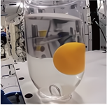

# Physics - 题目 952

**ID**: 0b6b063b612f4336a48171dfa5cb2c78
**年级**: Grade 9
**难度**: Easy
**题型**: Fill-in-the-blank

## 题目
“天宫一号”空间站处于微重力环境，重力可以忽略不计。​​​​​​​‌王亚平老师在空间站演示了如图所示的实验图，水中的乒乓球看起来变成椭圆了，这是光的现象；实验中乒乓球停留在水中，不会像地面实验时上浮，此时乒乓球上下表面受到的压力差等于。

## 解答

1. [1]水中的乒乓球反射的光在水面与空气交界处发生折射，人眼沿着折射光反向看向水中，感觉球是椭圆的。
2. [2]乒乓球停留在水中处于静止状态，竖直方向受到的重力和浮力是一对平衡力，大小相等，太空是失重状态，重力为0，所以浮力等于0，乒乓球上下表面受到的压力差即为浮力，所以乒乓球上下表面受到的压力差等于0。

## 知识点

**中文**:
  - 二力平衡的概念及平衡状态的判断
  - 光的折射现象

**English**:
  - Concept and Judgment of Equilibrium
  - Phenomenon of Refraction

---
