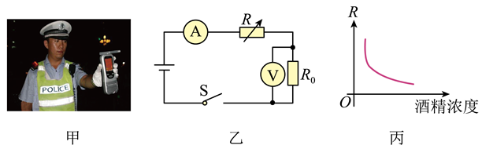

# Physics - 题目 2007

**ID**: 1153382549f94023ae8bc2d9c23dc41e
**年级**: Grade 9
**难度**: Easy
**题型**: Fill-in-the-blank

## 题目
节日期间，亲友聚餐饮酒机会增多，交警在重点路段查处酒驾醉驾以及各类交通违法行为，如图乙是一款酒精浓度监测仪的简化电路图，其电源电压不变，R_{0}为定值电阻，R为酒精气体浓度传感器，R的阻值与酒精浓度的关系如丙所示。​​​​​​​‌当接通电源时，驾驶员呼出的酒精浓度越大，电阻R越，电压表示数越，这时电压表和电流表的比值（填“变大”、“变小”或“不变”）。

## 解答

1. [1][2]当驾驶员呼出的酒精浓度越大时，由图丙可知传感器R的阻值越小，则电路的总电阻越小，根据欧姆定律可知，电路中电流也就越大，由欧姆定律可知R_{0}两端电压越大，即电压表示数越大。
2. [3]由欧姆定律可知，电压表与电流表示数的比值等于定值电阻R_{0}的阻值，所以该比值是不变的。

## 知识点

**中文**:
  - 动态电路中电表示数的变化

**English**:
  - Changes in Meter Readings in Dynamic Circuits

---
