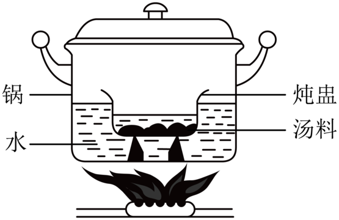

# Physics - 题目 2189

**ID**: 17c4e380a00646a9973ec132478ae30c
**年级**: Grade 9
**难度**: Easy
**题型**: Fill-in-the-blank

## 题目
煲汤和炖汤是两种各有千秋的烹调方式。​​​​​​​‌“煲”是指将锅直接置于火上焖煮，而“炖”则是使用隔水方式进行蒸煮（如图所示）。这两种方式都是通过的方式改变内能，若汤料的沸点与水的沸点相同，炖盅里的汤（选填“会”或“不会”）沸腾，原因是。

## 解答

1. “煲”和“炖”这两种方式都是内能的转移，是通过热传递的方式改变内能。
2. 液体沸腾需要两个条件：达到沸点，继续吸热，煲中的水达到沸点后，炖盅内的汤水也能达到沸点，汤水若要沸腾需要继续吸热，但由于炖盅和大煲中的水温度相同，不再发生热传递，所以盅内的汤不会沸腾。

## 知识点

**中文**:
  - 沸腾及沸腾条件
  - 热传递改变物体内能

**English**:
  - Boiling and Boiling Conditions
  - Changing Internal Energy by Heat Transfer

---
