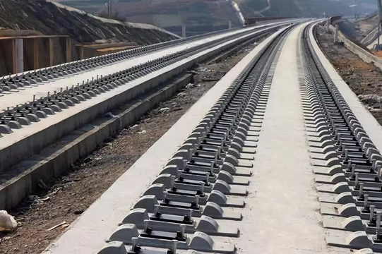

# Physics - 题目 1261

**ID**: 1d398de7a43048848d4d7c9287c9420b
**年级**: Grade 9
**难度**: Easy
**题型**: Fill-in-the-blank

## 题目
中国是世界上高铁规模最大、发展速度最快的国家。​​​​​​​‌如图是高速列车的无砟轨道，铁轨和轨枕直接铺在混凝土上，其路基不用碎石填充的原因是当列车高速运行时，列车底部和轨道之间空气流速变，压强变，碎石可能飞起来落到轨道上造成危险。在通往青藏高原的列车中，每节车厢内都配有供氧系统，这是为了预防由于海拔高度升高时，大气压强变，含氧量降低使乘客产生高原缺氧反应。（均选填“大”或“小”）

## 解答

1. 根据流体压强与流速的关系：在流体中，流速越大的位置压强越小，流速越小的位置压强越大。 当列车高速运行时，列车底部和轨道之间的空气流速会变大，根据上述规律可知，此时列车底部和轨道之间的压强会变小。
2. 大气压强随海拔高度的升高而减小。在通往青藏高原的列车中，海拔高度不断升高，大气压强会变小。

## 知识点

**中文**:
  - 流体压强与流速的关系

**English**:
  - Relationship between Fluid Pressure and Flow Speed

---
