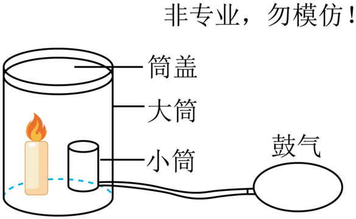

# Physics - 题目 1598

**ID**: 31b2979fcea942f68652de1877b9ed42
**年级**: Grade 9
**难度**: Easy
**题型**: Fill-in-the-blank

## 题目
在消防安全教育中，消防员给同学们做了“面粉爆炸实验”，如图所示，在无盖小筒里放入干燥面粉，点燃蜡烛，用筒盖盖上大筒，向小筒内鼓入空气，使面粉弥漫在大筒内，面粉迅速被点燃引发爆炸，把筒盖冲起。​​​​​​​‌筒盖被冲起的过程与汽油机的冲程能量转化情况相同。

## 解答

1. 面粉点燃时，化学能转化为内能；筒盖被冲起，内能转化为机械能。汽油机的做功冲程将内能转化为机械能，它们的能量转化情况相同。

## 知识点

**中文**:
  - 内燃机的四个冲程

**English**:
  - Four Strokes of Internal Combustion Engines

---
