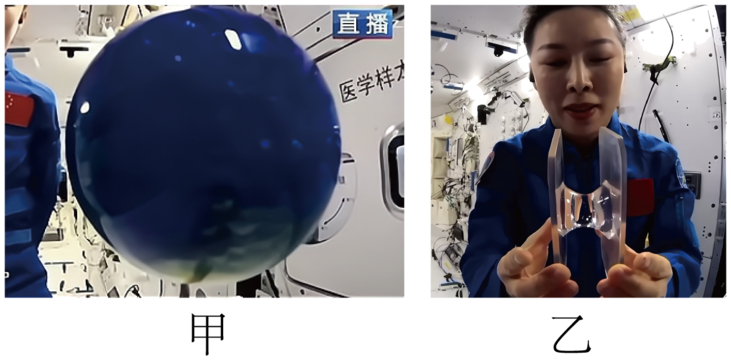

# Physics - 题目 1816

**ID**: 3244aad3348c4fe09da797bcfd4f63ba
**年级**: Grade 9
**难度**: Easy
**题型**: Fill-in-the-blank

## 题目
2021年12月9日，中国航天员在空间站上的“太空授课”精彩纷呈。​​​​​​​‌如图甲所示，她往水球中注入适量蓝颜料，很快水球整个就变蓝了，这是现象；如图乙所示，两块透明塑料板上的水球接触后融合成一体，然后将两块透明塑料板缓缓分开，水球被拉长成圆柱形，形成了一个长约 $10\{\rm{c}}{\rm{m}}$ 的液桥，说明分子间存在。

## 解答

1. [1]由图甲知，将蓝颜料滴入水球中，由于分子都在不停地做无规则运动，所以过一会儿水会变蓝了，这种现象属于扩散现象。
2. [2]由图乙知，由于分子间同时存在着引力与斥力，水球可以被拉长成圆柱形，主要是由于分子间存在引力。

## 知识点

**中文**:
  - 分子间的作用力
  - 扩散现象

**English**:
  - Intermolecular Forces
  - Diffusion

---
