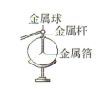

# Physics - 题目 1061

**ID**: 46693ffcc2ce48a096b31f3dd2a243c3
**年级**: Grade 9
**难度**: Easy
**题型**: Fill-in-the-blank

## 题目
原子是由原子核和核外高速运动的电子组成的，电子带电。​​​​​​​‌如图，当用毛皮摩擦过的橡胶棒触碰验电器的金属球时，金属箔张开，这时两个金属箔（选填“都带正电”“都带负电”“一边带正电一边带负电”或“不带电”）。

## 解答

1. 原子是由原子核和核外高速运动的电子组成的，原子核带正电，电子带负电。
2. 用毛皮摩擦过的橡胶棒带负电，去触碰验电器的金属球时，金属箔因带同种电荷张开，且这时两个金属箔都带负电。

## 知识点

**中文**:
  - 原子结构、元电荷与带电情况

**English**:
  - Atomic Structure, Elementary Charge, and Charging

---
