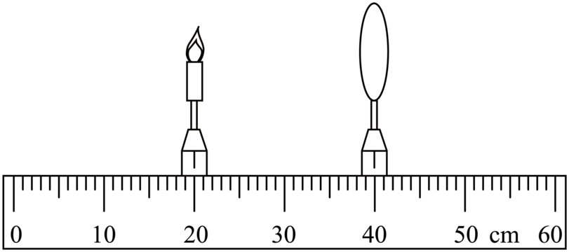

# Physics - 题目 2671

**ID**: 49bc034a994049fdaf79cf460884b11d
**年级**: Grade 9
**难度**: Easy
**题型**: Fill-in-the-blank

## 题目
如图所示，在探究凸透镜成像规律实验时，光屏（图中未画出）上恰好成清晰等大的像，由此可知此凸透镜焦距是cm；保持透镜位置不动，将蜡烛向（选填“左”或“右”）移动，适当移动光屏，可以成缩小的像。​​​​​​​‌

## 解答

1. 由图可知，此时物距为
2. u＝40.0cm﹣20.0cm＝20.0cm
3. 根据u＝v＝2f，成倒立、等大的实像，即2f＝20.0cm，故该凸透镜的焦距f＝10.0cm；根据凸透镜成实像时，物远像近像变小可知，保持透镜位置不动，将蜡烛向左移动，适当移动光屏，可以成缩小的像。

## 知识点

**中文**:
  - 凸透镜成像规律的应用

**English**:
  - Applications of Convex Lens Imaging

---
