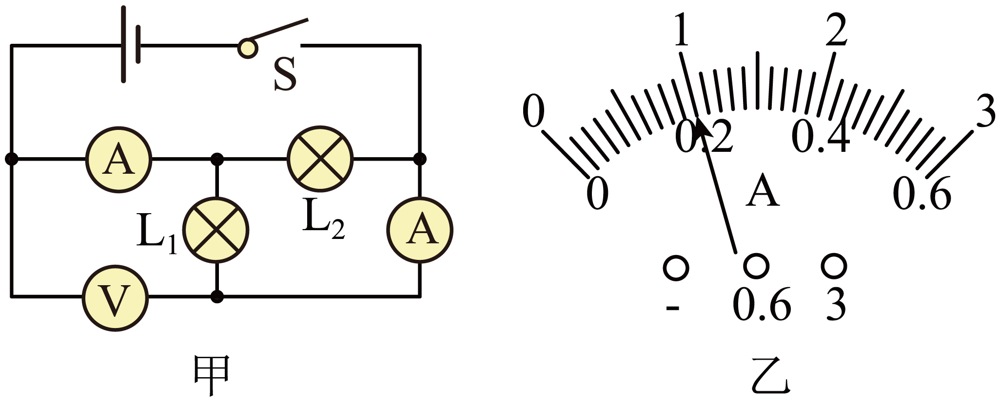

# Physics - 题目 2971

**ID**: 49c6ffade2554c89938f309d985447a8
**年级**: Grade 9
**难度**: Easy
**题型**: Fill-in-the-blank

## 题目
在如图甲所示的电路中，闭合开关S后，电压表的示数为3V，两个电流表的指针指在如图乙所示的同一位置。​​​​​​​‌通电相同时间，灯 ${\rm{L}}{{}_{1}}$ 和 ${\rm{L}}{{}_{2}}$ 消耗的电能之比为W_{1}∶W_{2}=。

## 解答

1. 图中L_{1}与L_{2}并联，左边电流表测量的是干路中的电流，右边电流表测量的是灯L_{1}中的电流，所以左边电流表的示数大于右边电流表的示数，左边电流表的量程为0~3A，分度值为0.1A，其示数为1A，右边电流表的量程是0~0.6A，分度值是0.02A，其示数为0.2A，即通过电灯L_{1}的电流
2. I_{1}=0.2A
3. 根据并联电路干路电流等于支路电流之和，所以通过电灯L_{2}的电流
4. I_{2}=I-I_{1}=1A-0.2A=0.8A
5. 并联电路中，各支路两端的电压相等，即L_{1}与L_{2}两端的电压相等，通电相同时间，灯 ${\rm{L}}{{}_{1}}$ 和 ${\rm{L}}{{}_{2}}$ 消耗的电能之比
6. $\frac {W{{}_{1}}}{W{{}_{2}}}=\frac {UI{{}_{1}}t}{UI{{}_{2}}t}=\frac {I{{}_{1}}}{I{{}_{2}}}=\frac {0.2{\rm{A}}}{0.8{\rm{A}}}=\frac {1}{4}$

## 知识点

**中文**:
  - 并联电路的电压规律
  - 电流表的读数
  - 并联电路的电流规律
  - 电功与电能的计算

**English**:
  - Voltage Law in Parallel Circuits
  - Reading an Ammeter
  - Current Law in Parallel Circuits
  - Calculation of Electric Work and Energy

---
