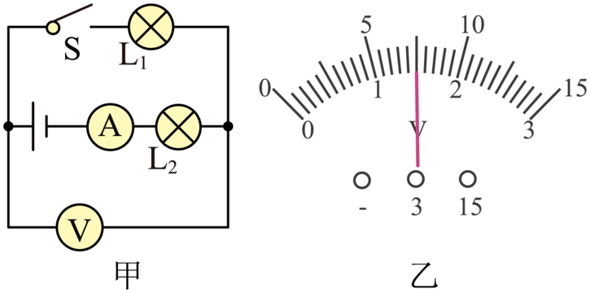

# Physics - 题目 1381

**ID**: 4e3e239edb8d4172a7ce26676ba76c31
**年级**: Grade 9
**难度**: Easy
**题型**: Fill-in-the-blank

## 题目
如图甲电路，电源电压6V， ${\rm{L}}{{}_{1}}$ 的电阻为10 $Ω$ ，当S闭合时，电压表的读数如图乙所示，则电流表示数为A， ${\rm{L}}{{}_{2}}$ 两端的电压为V。​​​​​​​‌

## 解答

1. 如图，两灯串联，电压表测L_{1}两端电压，电流表测电路中电流；电源电压为6V，故电压表示数为1.5V，电流表示数为 $I=I{{}_{1}}=\frac {U{{}_{1}}}{R{{}_{1}}}=\frac {{\rm{1}}{\rm{.}}{\rm{5}}{\rm{V}}}{{\rm{1}}{\rm{0}}{\rm{Ω}}}{\rm{=}}{\rm{0}}{\rm{.}}{\rm{1}}{\rm{5}}{\rm{A}}$
2. 根据串联电路电压规律可知，L_{2}两端电压为 $U{{}_{2}}=U-U{{}_{1}}=6{\rm{V}}-1.5{\rm{V}}=4.5{\rm{V}}$

## 知识点

**中文**:
  - 串联电路的电压规律
  - 欧姆定律的应用

**English**:
  - Voltage Law in Series Circuits
  - Applications of Ohm's Law

---
