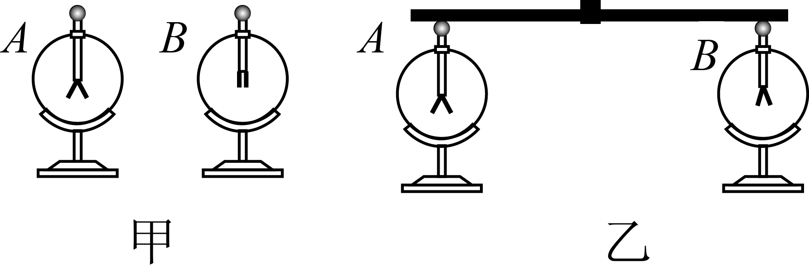

# Physics - 题目 998

**ID**: 4ee7760c138d4034b70b5dad56d19b16
**年级**: Grade 9
**难度**: Easy
**题型**: Fill-in-the-blank

## 题目
如图甲所示，验电器 $A$ 带负电， $B$ 不带电。​​​​​​​‌用带有绝缘柄的金属棒把验电器 $A$ 、 $B$ 两金属球连接起来的瞬间（如图乙所示），电流方向（选填“由 $A$ 到 $B$ ”或“由 $B$ 到 $A$ ”）；观察到 $A$ 的金属箔张开的角度减小， $B$ 的金属箔由闭合变为张开，是因为实验中金属杆和金属球接触的一瞬间， $B$ 验电器中的金属箔带上了电荷。

## 解答

1. [1][2]金属杆和金属球接触的一瞬间，A验电器上的部分负电荷转移到B验电器，使B验电器中的金属箔带上了负电荷，同种电荷相互排斥，B的金属箔由闭合变为张开；自由电子的定向移动方向与电流方向相反，所以金属棒中电流的方向是由B到A。

## 知识点

**中文**:
  - 电流的方向
  - 验电器的原理及使用

**English**:
  - Direction of Electric Current
  - Principle and Use of Electroscope

---
