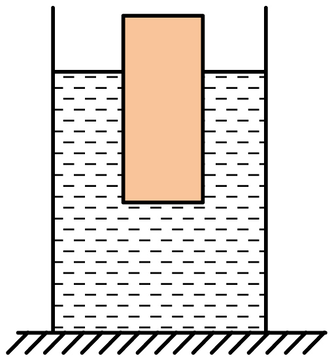

# Physics - 题目 168

**ID**: 4f814b450ab54c239ebbe2466e241ee7
**年级**: Grade 9
**难度**: Easy
**题型**: Fill-in-the-blank

## 题目
如图所示重力为4.9牛、体积为10^{-3}米^{3}的长方体木块静止在水面上，木块受到水的浮力大小为牛，方向。​​​​​​​‌若木块下表面所处的深度为0.1米，则长方体的底面积为米^{2}。

## 解答

1. 木块漂浮在水面上，受到的浮力F_{浮}=G=4.9N
2. 浮力的方向竖直向上。
3. 浮力是物体上下表面所受的压力差，下表面的压力大于上表面所受的压力，浮力方向与下表面所受压力方向相同，则F=pS=ρghS
4. 即4.9N=1.0×10^{3}kg/m^{3}×9.8N/kg×0.1m×S
5. 解得S=5×10^{-3}m^{2}。

## 知识点

**中文**:
  - 浮力大小的计算
  - 物体的浮沉条件及其应用

**English**:
  - Calculation of Buoyancy
  - Floating/Sinking Conditions and Applications

---
