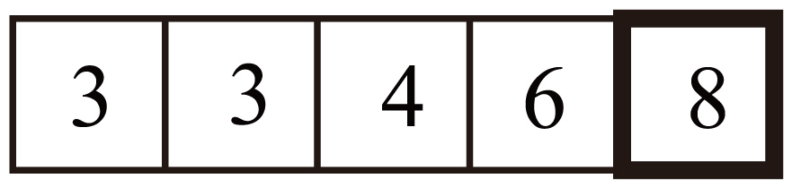
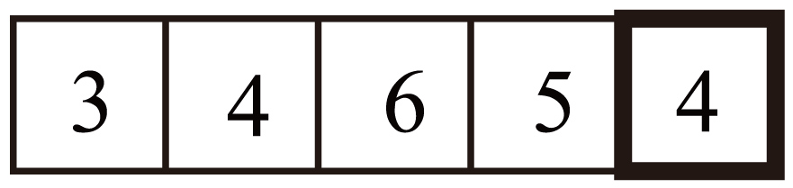

# Physics - 题目 354

**ID**: 504c533da66442e6aa5e06cdb333f87f
**年级**: Grade 9
**难度**: Easy
**题型**: Fill-in-the-blank

## 题目
一电能表显示月初时月末时则本月用电kW·h。​​​​​​​‌小明观察到电能表表盘上标明“1200r/（kW·h）”，他将某用电器单独接在该表上，当用电器工作一段时间后，电能表转盘转过60r，则该用电器这段时间消耗的电能是J

## 解答

1. 电能表示数最后一位为小数位，则本月用电量为
2. W=3465.4 kW·h-3346.8 kW·h= 118.6kW·h
3. 该用电器这段时间消耗的电能是
4. $W^{′}=\frac {n}{N}=\frac {60{\rm{r}}}{1200{\rm{r}}{\rm{/}}\left ({{\rm{k}}{\rm{W}}\cdot {\rm{h}}}\right )}=0.05{\rm{k}}{\rm{W}}\cdot {\rm{h}}=1.8\times 10{^{5}}{\rm{J}}$

## 知识点

**中文**:
  - 电能表的读数及电能的求解

**English**:
  - Reading Energy Meters and Calculating Energy

---
