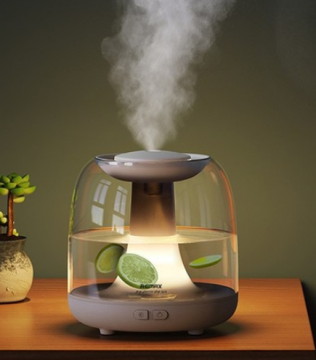

# Physics - 题目 595

**ID**: 5c73dbd541a24b66a61d91db67a4a178
**年级**: Grade 9
**难度**: Easy
**题型**: Fill-in-the-blank

## 题目
如图所示的超声波加湿器，它是利用超声波将水雾化，这说明声波可以传递（选填“能量”或“信息”）。​​​​​​​‌

## 解答

1. 声音可以传递信息与能量，超声波将水雾化，说明声波可以传递能量。

## 知识点

**中文**:
  - 声与能量

**English**:
  - Sound and Energy

---
