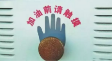

# Physics - 题目 1954

**ID**: 61d98c915df5454db718a08e18963219
**年级**: Grade 9
**难度**: Easy
**题型**: Fill-in-the-blank

## 题目
走近加油站，会闻到汽油的味道，这是现象；冬季在加油站不宜整理衣服和头发，因为易发生现象；加油前我们需要触摸加油机上的静电消除器（如图），此时会有瞬间电流由静电消除器流向人体，因为人体是（选填“绝缘体”、“半导体”或“导体”）。​​​​​​​‌

## 解答

1. [1][2][3]走近加油站，会闻到汽油的味道，是因为分子在做无规则运动，这是扩散现象。冬季在加油站不宜整理衣服和头发，因为易发生摩擦起电现象，加油前我们需要触摸加油机上的静电消除器避免因静电引起火灾；因为人体是导体，所以会有瞬间电流由静电消除器流向人体。

## 知识点

**中文**:
  - 导体和绝缘体的辨别
  - 扩散现象
  - 摩擦起电

**English**:
  - Distinguishing Conductors and Insulators
  - Diffusion
  - Triboelectricity / Charging by Friction

---
