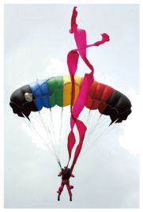

# Physics - 题目 337

**ID**: 6bdf22214e654eac9f99062128dbbff7
**年级**: Grade 9
**难度**: Easy
**题型**: Fill-in-the-blank

## 题目
如图所示，跳伞运动员远离飞机过程中，相对于飞机是（选填“运动”或“静止”）的；过一段时间后，他在空中匀速直线下降时，受（选填“平衡”或“非平衡”）力的作用。​​​​​​​‌

## 解答

1. 跳伞运动员远离飞机过程中，相对于飞机，位置发生改变，即相对于飞机是运动的。
2. 他在空中匀速直线下降时，运动状态不发生改变，受平衡力的作用。

## 知识点

**中文**:
  - 力与运动的关系
  - 运动和静止的相对性

**English**:
  - Relationship between Force and Motion
  - Relativity of Motion and Rest

---
