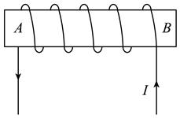

# Physics - 题目 2518

**ID**: 7413dbbe748e4c9b91e88a92e080871a
**年级**: Grade 9
**难度**: Easy
**题型**: Fill-in-the-blank

## 题目
根据图中的电流方向，可知通电螺线管的端是N极。​​​​​​​‌

## 解答

1. 用右手握住螺线管，四指的方向和电流方向相同，那么大拇指所指的A端即为螺线管的N极。

## 知识点

**中文**:
  - 安培定则及其应用

**English**:
  - Ampere's Rule and Applications

---
