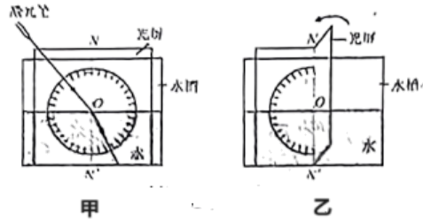

# Physics - 题目 2327

**ID**: 7bafe9d9551749f3a27a311781170928
**年级**: Grade 9
**难度**: Easy
**题型**: Fill-in-the-blank

## 题目
某小组选用了光源、水、水槽、可折转的光屏：（带刻度）等器材，用于完成探究“光从空气射入水中时的折射规律”；如图甲，将一束光线从空气中斜射入水中，发现折射角入射角（填“>”、“=”或“<”），将右半光屏向后折，折射光线消失，该现象说明了：。​​​​​​​‌

## 解答

1. [1]光在水中的速度小于空气中的速度，如图甲，将一束光线从空气中斜射入水中，发现折射角小于入射角。
2. [2]将光屏的右半部分向后翻折，就不会看到折射光线，只有当整个光屏为一平面时，才能够看到折射光线，说明入射光线、折射光线、法线在同一平面内。

## 知识点

**中文**:
  - 光的折射规律及其应用

**English**:
  - Law of Refraction and Applications

---
