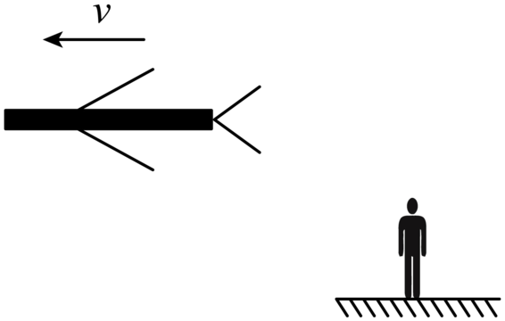

# Physics - 题目 141

**ID**: 8f4c3cb8aa0b44e59d43e72cd771ba39
**年级**: Grade 9
**难度**: Easy
**题型**: Fill-in-the-blank

## 题目
如图所示的军用飞机从上空高速飞过，观察者抬头看到飞机的同时，感觉到飞机发出的隆隆声是从飞机的方发出的（选填“前”或“后”），飞机在减速下降过程中，机械能将，势能将。​​​​​​​‌（选填“增大”“不变”或“减小”）

## 解答

1. 因为光的速度大于声音的速度，所以观察者抬头看到飞机的同时，感觉到飞机发出的隆隆声是从飞机的后方发出的；飞机在减速下降过程中，质量不变，速度和高度都变小，动能和重力势能都减小，机械能为动能和势能之和，所以机械能将减小；质量不变，高度减小，重力势能减小。

## 知识点

**中文**:
  - 光的传播速度与光年
  - 声速
  - 重力势能的变化问题
  - 机械能的变化问题

**English**:
  - Speed of Light and Light Years
  - Speed of Sound
  - Changes in Gravitational Potential Energy
  - Changes in Mechanical Energy

---
