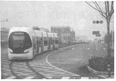

# Physics - 题目 2768

**ID**: 901f8409194d4e37b36d5146c910d3d4
**年级**: Grade 9
**难度**: Easy
**题型**: Fill-in-the-blank

## 题目
2018年4月1日，“光谷量子号”有轨电车开始载客试运营，开通了交路1和交路2两条线路．交路2全长约20km，若电车某次跑完全程需要50min，则电车的平均速度为km/h．“光谷量子号”采用了能量回收系统，例如电车下坡时，为了保持匀速运动，会带动发电机发电进行“刹车”，即将能转化为能供电车使用，更加节能环保．​​​​​​​‌

## 解答

1. 解：（1）t＝50min＝ $\frac {5}{6}$ h，v＝ $\frac {s}{t}＝\frac {20km}{\frac {5}{6}h}$ ＝24km/h；（2）下坡时带动发电机发电进行“刹车”，发电机工作时将机械能转化为电能，故答案为机械能和电能．
2. 点睛：已知路程和时间，根据公式算出平均速度；发电机工作时将机械能转化为电能．

## 知识点

**中文**:
  - 平均速度及其计算
  - 能量的转化

**English**:
  - Average Velocity and Calculation
  - Transformation of Energy

---
