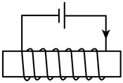

# Physics - 题目 517

**ID**: 954b946dbb5145e391e5740415fd08c1
**年级**: Grade 9
**难度**: Easy
**题型**: Fill-in-the-blank

## 题目
如图所示，请根据通电螺线管中的电流方向，判断通电螺线管的左端是极。​​​​​​​‌

## 解答

1. 如图，电流从螺线管右端流入，左端流出；根据安培定则，用右手握住螺线管，四指的的环绕方向为螺线管中电流的方向，大拇指指向的一端就是螺线管的N极，即左端为螺线管的N极。

## 知识点

**中文**:
  - 安培定则及其应用

**English**:
  - Ampere's Rule and Applications

---
