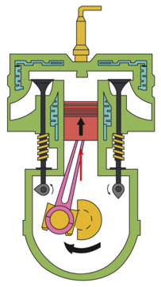

# Physics - 题目 2484

**ID**: 9d175786b76047dfba1b6f1b68aa6255
**年级**: Grade 9
**难度**: Easy
**题型**: Fill-in-the-blank

## 题目
热机的广泛应用标志着人类大规模利用动力时代的到来。​​​​​​​‌图是热机工作的冲程，热机工作时要产生大量的热，人们常用水给汽车发动机降温，这是因为水的较大；在这个过程中是通过的方式使水的温度升高，内能增大。

## 解答

1. 图示中，进气门及排气门都关闭，活塞向上运动，是压缩冲程。
2. 因为水的比热容较大，相同质量的水与其它物质相比，吸收相同热量时，水升温不明显，所以用来给发动机降温。
3. 水给发动机降温的过程是水吸收了热量温度升高，这是通过热传递的方式让水的内能增大的。

## 知识点

**中文**:
  - 内燃机的四个冲程
  - 热传递改变物体内能
  - 水的比热容的特点及应用

**English**:
  - Four Strokes of Internal Combustion Engines
  - Changing Internal Energy by Heat Transfer
  - Characteristics and Applications of Water's Specific Heat

---
