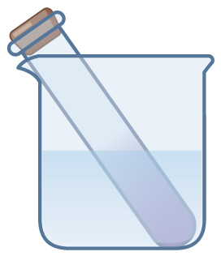

# Physics - 题目 1629

**ID**: a40f19810fef43ab9eee42e9e5302ca2
**年级**: Grade 9
**难度**: Easy
**题型**: Fill-in-the-blank

## 题目
碘是人体必需的微量元素之一。​​​​​​​‌碘的熔点为113.7℃，固态碘是（选填“晶体”或“非晶体”）。如图所示，在试管中放入少量的碘，将试管放入热水中，固态碘会（选填“吸收”或“放出”）热量，迅速（填物态变化名称）为碘蒸气。

## 解答

1. 固态碘有固定熔点，是晶体。固态碘变成气态的碘蒸气，是升华现象，需要吸热。

## 知识点

**中文**:
  - 升华的定义和特点
  - 晶体和非晶体的区别

**English**:
  - Definition and Characteristics of Sublimation
  - Difference between Crystals and Amorphous Solids

---
