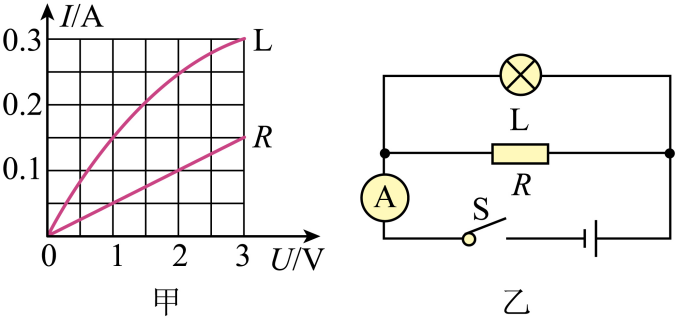

# Physics - 题目 2175

**ID**: a4ba8c8763f4412a8271f08af3e57302
**年级**: Grade 9
**难度**: Easy
**题型**: Fill-in-the-blank

## 题目
图甲是灯L和电阻R的I—U图像，将它们并联接在如图乙所示电路中，若电源电压恒为2V，闭合开关，则电流表的示数为A，灯L的实际功率为W。​​​​​​​‌

## 解答

1. 由图乙可知，灯泡L与定值电阻R并联，电流表测干路电流；由图像可知电压为2V时，通过电阻的电流为I_{R}=0.1A，通过灯泡的电流I_{L}=0.25A，干路电流等于支路电流之和，电流表的示数I=I_{L}+I_{R}=0.25A+0.1A=0.35A，灯L的实际功率为P_{L}=U_{L}I_{L}=2V×0.25A=0.5W。

## 知识点

**中文**:
  - 并联电路的电流规律
  - 电功率的计算及应用

**English**:
  - Current Law in Parallel Circuits
  - Calculation and Application of Electric Power

---
