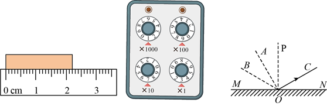

# Physics - 题目 52

**ID**: a7f1dd972f014af5838659be9567eb19
**年级**: Grade 9
**难度**: Easy
**题型**: Fill-in-the-blank

## 题目
（1）如图所示，木块的长度是cm；（2）如图所示，电阻箱的示数为Ω；（3）如图所示，MN是平面镜，OP是法线。​​​​​​​‌一束光入射到平面镜上的O点后沿OC方向射出，已知ÐPOA=ÐMOB=ÐNOC=30°。则这束光是沿着图中的（选填“AO”或“BO”）方向射入，它的入射角大小等于°。

## 解答

1. （1）[1]由图可知，刻度尺的分度值是1mm，木块的左端从0刻度开始，右端刻度值是2.20cm，因此木块的长度为2.20cm。
2. （2）[2]该电阻箱的示数
3. R=1×1000Ω+9×100Ω+7×10Ω+3×1Ω=1973Ω
4. （3）[3][4]反射角是反射光线与法线的夹角，由图可知，反射角
5. ∠POC=90°-∠NOC=90°-30°=60°
6. 由图可知
7. ∠POB=90°-∠MOB=90°-30°=60°
8. 在光的反射中，由于反射角等于入射角，所以入射角为∠POB=60°，所以这束光是沿着图中的BO方向射入。

## 知识点

**中文**:
  - 光的反射定律及其应用
  - 刻度尺的使用
  - 电阻箱的使用

**English**:
  - Law of Reflection and Applications
  - Use of Ruler/Scale
  - Using a Resistance Box

---
