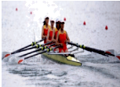

# Physics - 题目 2769

**ID**: a968ef33b8634be89315b3b78e17f54c
**年级**: Grade 9
**难度**: Easy
**题型**: Fill-in-the-blank

## 题目
如图所示是赛艇的场景，赛艇的桨可看成一个杠杆，赛艇的桨属于杠杆（选填“省力”或“费力”），赛艇刚刚划过终点线时，由于赛艇具有，还能保持原有的运动状态。​​​​​​​‌

## 解答

1. [1]因为赛艇的桨的动力臂小于阻力臂，所以是费力杠杆。
2. [2]赛艇刚刚划过终点线时，还要继续向前运动，是由于惯性还要保持原来的运动状态。

## 知识点

**中文**:
  - 杠杆的分类
  - 生活中的惯性现象

**English**:
  - Classification of Levers
  - Inertia Phenomena in Daily Life

---
