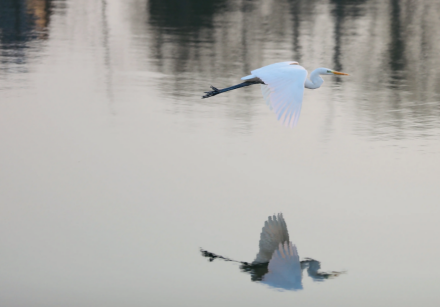

# Physics - 题目 1453

**ID**: bf471939d4eb438e9480a685edad3f0b
**年级**: Grade 9
**难度**: Easy
**题型**: Fill-in-the-blank

## 题目
“西塞山前白鹭飞，桃花流水鳜鱼肥”是唐代张志和的词句。​​​​​​​‌如图所示，在平静湖面上方，一只白鹭水平滑翔。若以白鹭为参照物，它在水中的倒影是（选填“运动”或“静止”）的，白鹭向上高飞时，则白鹭在水中倒影的大小（填变小、变大或不变）。

## 解答

1. 白鹭在水中的倒影相对于白鹭没有位置的改变，所以以白鹭为参照物，它在水中的倒影是静止的。
2. 因为白鹭在水中的倒影和白鹭关于水面是对称的，所以白鹭在水中倒影的大小不变。

## 知识点

**中文**:
  - 平面镜成像的特点、原理及现象
  - 运动和静止的相对性

**English**:
  - Characteristics, Principles, and Phenomena
  - Relativity of Motion and Rest

---
