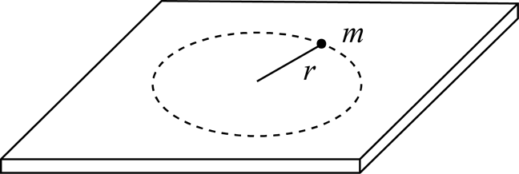

# Physics - 题目 135

**ID**: bfb2271499f5468fbad73998601c17b0
**年级**: Grade 9
**难度**: Easy
**题型**: Fill-in-the-blank

## 题目
如图所示，在平放水平桌面的装置上拴一质量为m的小球，在细绳的拉力作用下做速度大小不变且半径为r的匀速圆周运动，则小球的运动状态（选填“发生”或“不发生”）改变；细绳的拉力对小球（选填“做”或“不做”）功；重力对小球功（选填同上）。​​​​​​​‌

## 解答

1. 小球做匀速圆周运动，方向不断在变化，则小球的运动状态发生改变。
2. 小球做匀速圆周运动，小球在拉力方向上没有运动距离，拉力对小球不做功。
3. 小球在重力方向上没有运动距离，重力对小球不做功。

## 知识点

**中文**:
  - 力做功的必要条件
  - 力的作用效果

**English**:
  - Necessary Conditions for Work
  - Effects of Force

---
