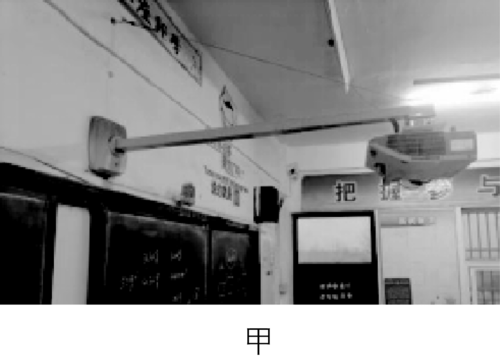
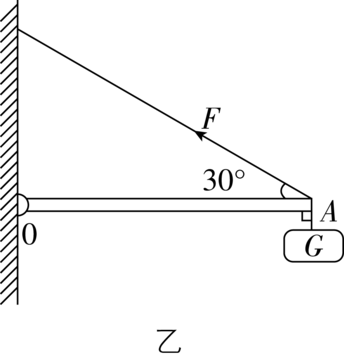

# Physics - 题目 13

**ID**: c39d4b2af3b34f8b8f70e4fcfebfdecb
**年级**: Grade 9
**难度**: Easy
**题型**: Fill-in-the-blank

## 题目
图甲是希望中学九(1)班的投影仪安装示意图，杠杆模型可简化为图乙所示，水平杆OA可绕点O转动，钢丝绳与水平杆之间的夹角是30°，若投影仪质量为2kg，则钢丝绳的拉力F为N(不计水平杆OA的重力，g取10N/kg)。​​​​​​​‌

## 解答

1. 
2. 投影仪受到的重力G＝mg＝2 kg×10 N/kg＝20 N，过点O作钢丝绳的垂线，与钢丝绳交于点B，如图所示，易知OB＝ $\frac{1}{2}$OA，由F·OB＝G·OA得：F＝ $\frac{OA}{OB}$ ·G＝2×20 N＝40 N。

## 知识点

**中文**:
  - 杠杆平衡条件的应用

**English**:
  - Application of Lever Equilibrium Conditions

---
