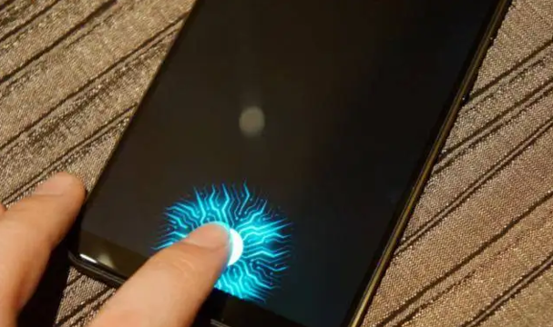

# Physics - 题目 2142

**ID**: d75b96b2864c4aad8b59193e57ba163d
**年级**: Grade 9
**难度**: Easy
**题型**: Fill-in-the-blank

## 题目
如图所示，指纹识别解锁是目前较为流行的手机解锁方式，手指轻轻触碰感应区，识别出正确的指纹后手机自动开锁，则感应区相当于手机电路中的；手机有较好的防水保护功能，是为了防止线路过于潮湿出现（选填“短路”或“断路”）现象。​​​​​​​‌

## 解答

1. 手指轻轻触碰感应区，识别出正确的指纹后手机自动开锁，可以看出感应区起到了控制电路通断的作用，相当于电路中的开关。
2. 通常情况下水是导体，手机有较好的防水保护功能，是为了防止水进入手机内部使线路过于潮湿出现短路，造成线路中电流过大而损坏手机。

## 知识点

**中文**:
  - 电路的组成与连接
  - 通路、断路和短路

**English**:
  - Components and Connection of Circuits
  - Closed, Open, and Short Circuits

---
