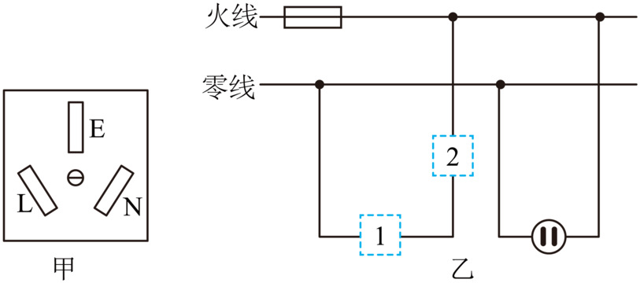

# Physics - 题目 1164

**ID**: df21c786c24547cd9bb250b73606e9fc
**年级**: Grade 9
**难度**: Easy
**题型**: Fill-in-the-blank

## 题目
如图甲所示，插头中较长的插脚应该插入三孔插座的（选填“L”“N”或“E”）孔；小明同学想在家里安装一盏照明灯，图乙所示是他设计的电路，图中虚线框1和2应连入开关和电灯，则开关应装在方框（选填“1”或“2”）中。​​​​​​​‌

## 解答

1. 三脚插头中，较长的插脚是为了安全设计的，它代表的是接地线，因此插头中较长的插脚应该插入三孔插座的E孔。
2. 根据家庭电路的连接规则，开关应该接在火线上，所以开关应该安装在2上。

## 知识点

**中文**:
  - 家庭电路的连接
  - 插座和插头的接线及作用

**English**:
  - Connection of Household Circuits
  - Wiring and Function of Sockets and Plugs

---
