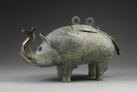

# Physics - 题目 2783

**ID**: df418e63afcd4dbd9caab923dc73ea6f
**年级**: Grade 9
**难度**: Easy
**题型**: Fill-in-the-blank

## 题目
如图所示是我国西周时期的一个盛酒容器——青铜象尊，在象尊的整体构造中，象腹中空，能盛大量酒水，上卷的象鼻与腹部相通，方便倒酒。​​​​​​​‌象鼻和象腹构成了一个，象尊内注满酒后，酒不会从象鼻溢出，原因是。

## 解答

1. 上端开口、底部相连通的容器叫做连通器，连通器中的各容器的形状不受限制，既可以是直筒的，又可以是弯曲的，各容器的粗细程度也可以不同，故象鼻和象腹构成了一个连通器；连通器的原理为连通器中装入同一种液体，当液体不流动时，各容器中的液面总保持相平，故象尊内注满酒后，酒不会从象鼻溢出，是因为当液体不流动时，连通器各部分中的液面高度相同。

## 知识点

**中文**:
  - 连通器原理

**English**:
  - Principle of Communicating Vessels

---
