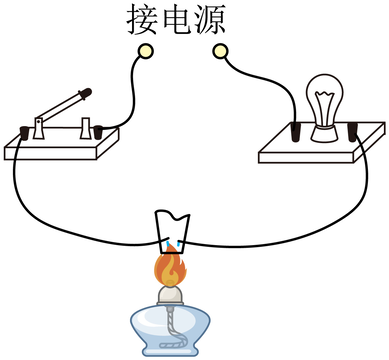

# Physics - 题目 1962

**ID**: e0a8084ed6224a2aafd004ac14693669
**年级**: Grade 9
**难度**: Easy
**题型**: Fill-in-the-blank

## 题目
如图，闭合开关后，灯泡不发光。​​​​​​​‌加热废灯泡灯芯的玻璃柱到红炽状态，小灯泡，这是因为常温下的玻璃是，高温下的玻璃变成了。（后两空选填“导体”或“绝缘体”）

## 解答

1. 把废灯泡灯芯的玻璃柱接入电路中，闭合开关，发现小灯泡不发光，说明常温下的玻璃不容易导电，是绝缘体。
2. 当玻璃柱加热到红炽状态时，发现小灯泡发光，说明玻璃在加热到红炽状态时，会容易导电，变为导体，故小灯泡发光。

## 知识点

**中文**:
  - 导体和绝缘体的辨别

**English**:
  - Distinguishing Conductors and Insulators

---
