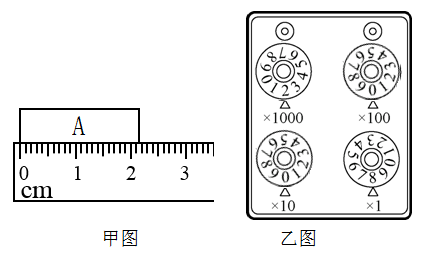

# Physics - 题目 1250

**ID**: e65477abd63b4e499d81a06d5db83d19
**年级**: Grade 9
**难度**: Easy
**题型**: Fill-in-the-blank

## 题目
甲图中物体A的长度为cm，乙图中电阻箱的阻值为Ω。​​​​​​​‌

## 解答

1. [1]刻度尺的分度值是0.1cm，估计到0.01cm，物体A的末端在刻度尺的2.10cm和2.20 cm刻度线之间略偏向2.10cm，故物体A的长度为2.14m。
2. [2]电阻箱的读数为
3. R=2×1000Ω+0×100Ω+0×10Ω+1×8Ω=2008Ω

## 知识点

**中文**:
  - 电阻箱的使用
  - 长度的测量

**English**:
  - Using a Resistance Box
  - Measurement of Length

---
