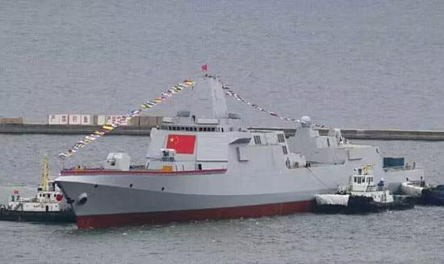

# Physics - 题目 1198

**ID**: ec64537cded4470dae93ed76e84c7cad
**年级**: Grade 9
**难度**: Easy
**题型**: Fill-in-the-blank

## 题目
如图所示，是我国新型万吨级055型导弹驱逐舰，其满载排水量达12500t。​​​​​​​‌该型驱逐舰我国南海海上满载巡航过程中，驱逐舰所受浮力的大小是N；浮力的方向是；当它发射导弹后，驱逐舰所受浮力（选填“变大”、“变小”或“不变”）。

## 解答

1. 根据题意可知，驱逐舰所受浮力的大小是 $F{{}_{浮}}=G{{}_{排}}=m{{}_{排}}g=12500\times 10{^{3}}{\rm{k}}{\rm{g}}\times 10{\rm{N}}{\rm{/}}{\rm{k}}{\rm{g}}=1.25\times 10{^{8}}{\rm{N}}$ ，驱逐舰我国南海海上巡航过程中，驱逐舰所受浮力的方向是竖直向上；当它发射导弹后，驱逐舰受到的总重力减小，又因为驱逐舰漂浮在水面，由物体沉浮条件可知，驱逐舰受到的浮力等于驱逐舰的总重力，所以驱逐舰所受浮力变小。

## 知识点

**中文**:
  - 浮力的方向及产生原因
  - 阿基米德原理的应用
  - 物体的浮沉条件及其应用

**English**:
  - Direction and Cause of Buoyancy
  - Applications of Archimedes' Principle
  - Floating/Sinking Conditions and Applications

---
