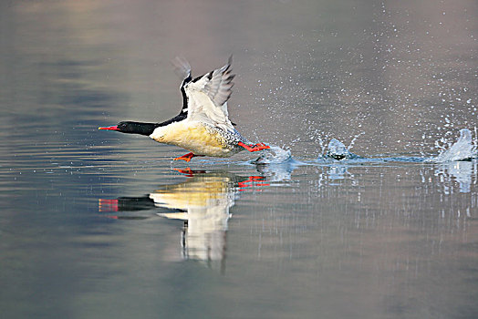

# Physics - 题目 2145

**ID**: ecafc400db6c4802a31f9d099d6bdd5d
**年级**: Grade 9
**难度**: Easy
**题型**: Fill-in-the-blank

## 题目
如图所示是国家重点保护野生动物中华秋沙鸭飞离水面时的情景，它在水中的像是由光的（选填“反射”或“折射”）形成的，远离水面时水中像的大小将（选填“变大”“变小”或“不变”）；从物理学的角度分析：湿地的水面面积大，可以调节周边气温，主要是因为水的较大。​​​​​​​‌

## 解答

1. 倒影属于平面镜成像，因为平面镜成的像是反射光线的反向延长线会聚于一点形成的，所以是光的反射原理。平面镜所成的像与物体大小始终相等，当距离平面镜较远时，像看起来小了，这是视角变小的缘故，实际像和物体的大小都没变。湿地含有水，因为水的比热容较大，根据 $Q=cmΔt$ 可知，白天，相同质量的水和沙石比较，吸收相同的热量，水的温度升高的少；夜晚，放出相同的热量，水的温度降低的少，使得昼夜的温差小，故能有效调节周围环境的气温。

## 知识点

**中文**:
  - 光的反射现象
  - 平面镜成像的特点、原理及现象
  - 水的比热容的特点及应用

**English**:
  - Phenomenon of Light Reflection
  - Characteristics, Principles, and Phenomena
  - Characteristics and Applications of Water's Specific Heat

---
