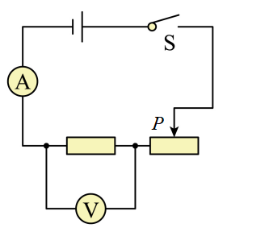

# Physics - 题目 2453

**ID**: f7dcbba14989429dbc88b8bc3f1ec0c6
**年级**: Grade 9
**难度**: Easy
**题型**: Fill-in-the-blank

## 题目
如图所示是小李同学为探究“电流与电压的关系”设计的电路图，他准备根据此电路图连接好实物电路并进行实验，实验时，应该控制不变；若在实验前检查仪器时，发现电流表的指针在零刻度线左侧，造成这一现象的原因是。​​​​​​​‌

## 解答

1. 探究“电流与电压的关系”时，根据控制变量法，应控制电阻不变，改变电阻两端的电压；实验前检查仪器时，发现电流表的指针在零刻度线左侧，说明电流表未调零。

## 知识点

**中文**:
  - 电流与电压关系的探究实验
  - 电流表的使用

**English**:
  - Experiment: Relationship between Current and Voltage
  - Using an Ammeter

---
