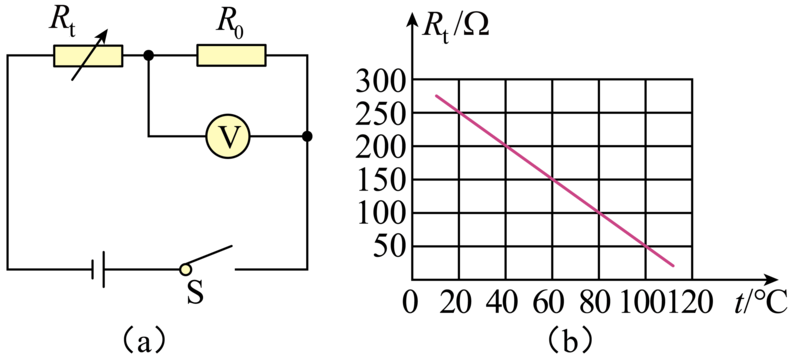

# Physics - 题目 1736

**ID**: f9929764938b48c6a9802991cd41f142
**年级**: Grade 9
**难度**: Easy
**题型**: Fill-in-the-blank

## 题目
在创客比赛中，晓光设计了暖箱温度显示器，如图（a）所示，其原理是利用电压表的示数表示暖箱内的温度。​​​​​​​‌已知电源电压恒定为4V，R_{0}的阻值为150Ω，R_{t}是热敏电阻，图（b）是它的阻值一温度的关系图像。当暖箱内温度为60℃时，电压表的示数是V，电压表的量程为0~3V，则暖箱内的最高温度是℃。若将R_{0}换用阻值更大的电阻，则暖箱内能达到的最高温度将（选填“升高”、“降低”或“不变”）。

## 解答

1. [1]如图所示，两电阻串联，电压表测R_{0}两端电压，当暖箱内温度为60℃时,  $R{{}_{{\rm{t}}}}=150\Omega $ ，则
2. $R{{}_{{\rm{t}}}}=R{{}_{0}}=150\Omega $
3. 根据串联电路分压的规律，此时
4. $U{{}_{0}}=U{{}_{{\rm{t}}}}=\frac {1}{2}U=\frac {1}{2}\times 4{\rm{V}}=2{\rm{V}}$
5. 则电压表的示数为2V。
6. [2][3]当电压表示数为3V时，R_{t}两端电压为
7. $U{{}_{{\rm{t}}}^{^{′}}}=U-U{{}_{0}^{^{′}}}=4{\rm{V}}-3{\rm{V}}=1{\rm{V}}$
8. 则有
9. $\frac {U{{}_{{\rm{t}}}^{^{′}}}}{R{{}_{{\rm{t}}}^{^{′}}}}=\frac {U{{}_{0}^{^{′}}}}{R{{}_{0}}}$
10. 则此时R_{t}的阻值为
11. $R{{}_{{\rm{t}}}^{^{′}}}=\frac {U{{}_{{\rm{t}}}^{^{′}}}}{U{{}_{0}^{^{′}}}}R{{}_{0}}=\frac {1{\rm{V}}}{3{\rm{V}}}\times 150\Omega =50\Omega $
12. 如图所示，此时最高温度为100℃。若将R_{0}换用阻值更大的电阻，则R_{t}的阻值更会更大，暖箱内能达到的最高温度将降低。

## 知识点

**中文**:
  - 串联电路的电压规律
  - 欧姆定律的应用

**English**:
  - Voltage Law in Series Circuits
  - Applications of Ohm's Law

---
