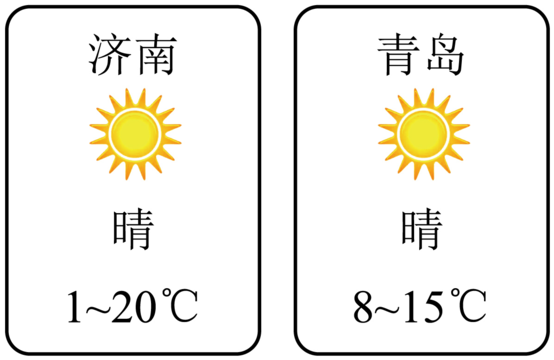

# Physics - 题目 1392

**ID**: 01113ba2068f4d01918ad1fc5a67d0c8
**年级**: Grade 9
**难度**: Easy
**题型**: Multiple-choice

## 题目
如图所示，为济南和青岛两市同一天的天气预报。​​​​​​​‌由图可知：济南和青岛这一天都是晴朗天气，但济南的温差明显大于青岛。从物理学的角度看，这主要是因为（      ）

## 解答

1. 由于青岛是沿海城市，济南是内陆城市，海水的比热容比砂石的比热容大，相同质量的海水和砂石，吸收或放出相同的热量时，海水的温度比砂石的温度变化少，所以青岛的温差比济南的温差小，与密度、内能、温度都无关，故C符合题意，ABD不符合题意。

## 知识点

**中文**:
  - 生活中的比热容问题

**English**:
  - Specific Heat Capacity in Daily Life

---
