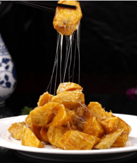

# Physics - 题目 1255

**ID**: 082f2a5b4fc24458a61fbf4a12ad8dd3
**年级**: Grade 9
**难度**: Easy
**题型**: Multiple-choice

## 题目
如图，刚出锅的“拔丝红薯”香气四溢，夹起一块红薯时就会拉出很长的丝，下列说法正确的是（      ）​​​​​​​‌

## 解答

1. A．“拔丝红薯”香气四溢，说明分子在不停地做无规则运动，是扩散现象，故A正确；
2. B．一切物体在任何情况下都有内能，故B错误；
3. C．分子间存在引力和斥力，夹起红薯时会拉出很长的丝是因为分子间有引力，故C错误；
4. D．红薯变凉后很难分开，说明糖分子间的作用力变大，故D错误。

## 知识点

**中文**:
  - 内能的概念
  - 扩散现象
  - 分子间的作用力

**English**:
  - Concept of Internal Energy
  - Diffusion
  - Intermolecular Forces

---
