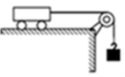

# Physics - 题目 1546

**ID**: 08322cb17e084b6d9a24eed202d88b78
**年级**: Grade 9
**难度**: Easy
**题型**: Multiple-choice

## 题目
如图所示，将小车放在水平桌面上，用轻绳跨过定滑轮与钩码相连，在轻绳的拉力作用下沿桌面做匀速运动．若突然剪断轻绳，则小车 $($      $)$​​​​​​​‌

## 解答

1. 由小车沿桌面做匀速运动知道，小车受到的力是平衡力，即竖直方向上重力和支持力是平衡力，水平方向上拉力和摩擦力是平衡力；若突然剪断轻绳，拉力消失，在水平方向上运动小车只受向左的摩擦力，由于摩擦力方向与小车的运动方向相反，所以小车做减速运动，速度越来越慢，故A正确，BC错误；影响摩擦力的因素是压力和接触面的粗糙程度，当突然剪断轻绳时，小车对接触面的压力与接触面的粗糙程度都不变，所以受到的摩擦力大小不变，故D错误，故选A。

## 知识点

**中文**:
  - 二力平衡的条件及其应用

**English**:
  - Conditions and Applications of Two-Force Equilibrium

---
