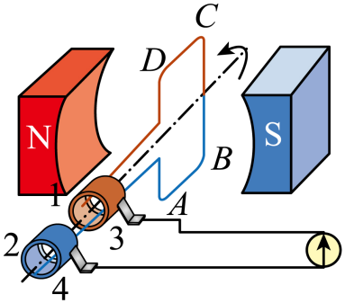

# Physics - 题目 1288

**ID**: 0b01aa82420c4db2a9bfc5d6514e78d0
**年级**: Grade 9
**难度**: Easy
**题型**: Multiple-choice

## 题目
如图是交流发电机的原理图，此时线圈平面与磁感线垂直，则（      ）​​​​​​​‌

## 解答

1. A．图中所示位置，线圈与磁感线垂直，转动到图示位置的瞬间不切割磁感线，不会产生感应电流，故A符合题意；
2. BC．发电机的工作原理是电磁感应现象，此过程中，消耗机械能，产生电能，机械能转化为电能，故BC不符合题意；
3. D．线圈匀速转动时，线圈平面与磁场的夹角会发生变化，当两个转动边垂直切割磁感线时，产生的感应电流最大，所以线圈中产生的电流大小是变化的，故D不符合题意。
4. 故选A。

## 知识点

**中文**:
  - 产生感应电流的条件
  - 影响感应电流方向的因素

**English**:
  - Conditions for Induced Current
  - Factors Affecting Direction of Induced Current

---
