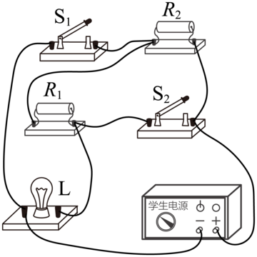

# Physics - 题目 1904

**ID**: 0f79e47a50ca4b4aa5ac591d6ab61892
**年级**: Grade 9
**难度**: Easy
**题型**: Multiple-choice

## 题目
如图所示的电路中，各元件完好，关于整个电路的连接，下列判断中正确的是（      ）​​​​​​​‌

## 解答

1. A．若只闭合S_{1}，电流从电源正极流出，经过R_{2}、开关S_{1}回到电源的负极，电路为R_{2}串联的简单电路，故A错误；
2. BC．若只闭合S_{2}，电流从电源正极流出，经过开关S_{2}、灯泡L直接回到电源的负极，电路为L串联的简单电路，故BC错误；
3. D．若S_{1}、S_{2}都断开，电流从电源的正极流出，依次经过R_{2}、R_{1}、灯泡L回到电源的负极，电路是R_{2}、R_{1}、灯泡L串联，故D正确。

## 知识点

**中文**:
  - 串联电路和并联电路的辨别

**English**:
  - Distinguishing Series and Parallel Circuits

---
